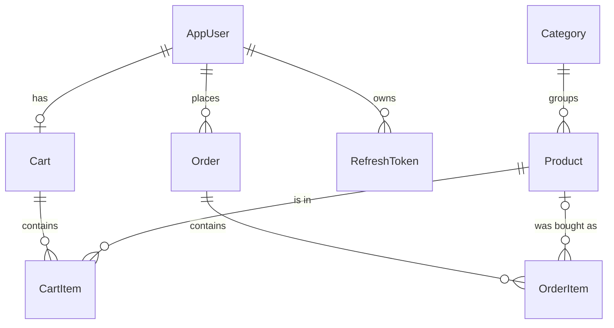

# Market API

A supermarket backend built with **ASP.NET Core (.NET 10)**. It exposes a **REST** API and a **GraphQL** endpoint over the same service layer, with JWT authentication, an admin role, a Redis cache, and a checkout flow that is safe under concurrent requests.

There is no frontend. The API is explored with the included `market.http` file or with the GraphQL IDE (Nitro) at `/graphql`.

## Tech stack

| Area | Technology |
|---|---|
| Framework | ASP.NET Core, .NET 10 |
| Database | SQL Server, EF Core (code-first migrations) |
| Users and roles | ASP.NET Core Identity (`IdentityCore`, no cookies/UI) |
| Authentication | JWT access tokens and rotating refresh tokens |
| Cache | Redis (`StackExchange.Redis`) |
| GraphQL | HotChocolate (paging, filtering, sorting, projections) |
| Packaging | Docker, Docker Compose |

## Quick start (Docker)

Requires Docker Desktop (or Docker Engine with the Compose plugin). Nothing else needs to be installed.

```bash
cp .env.example .env          # Windows PowerShell: copy .env.example .env
docker compose up --build
```

The first run downloads images and builds the project, which takes a few minutes. When the log shows `Now listening on: http://[::]:8080`, the API is ready.

| What | URL |
|---|---|
| GraphQL IDE (Nitro) | http://localhost:8080/graphql |
| REST API | http://localhost:8080/api/... |

**Default admin:** `admin@market.local`, with the password from `ADMIN_PASSWORD` in your `.env` (the example file uses `Admin@12345`).

On startup the app applies migrations, creates the roles and the admin user, and seeds 3 categories and 4 products.

Configuration (`.env`):

| Variable | Purpose |
|---|---|
| `SA_PASSWORD` | SQL Server `sa` password (at least 8 characters, upper and lower case, digit, symbol) |
| `JWT_KEY` | Secret used to sign tokens (at least 32 characters) |
| `ADMIN_PASSWORD` | Password of the seeded admin (must satisfy the Identity password rules) |
| `API_PORT` | Optional, host port of the API (default `8080`) |

Values must not contain `;`, `$`, or spaces.

Useful commands:

```bash
docker compose down          # stop, keep the data
docker compose down -v       # stop and delete the database volume
docker compose logs api      # API logs
```

If the API port is already taken, set `API_PORT` in `.env` (for example `API_PORT=8181`).

### Running without the API container

You can run only the dependencies in Docker and run the API from your IDE or `dotnet run`:

```bash
docker compose up db redis
dotnet user-secrets set "Jwt:Key" "<at least 32 characters>"
dotnet user-secrets set "Seed:AdminPassword" "<a strong password>"
dotnet user-secrets set "ConnectionStrings:DefaultConnection" "Server=localhost,14330;Database=MarketDb;User Id=sa;Password=<SA_PASSWORD>;TrustServerCertificate=True"
dotnet user-secrets set "ConnectionStrings:Redis" "localhost:16379,abortConnect=false"
dotnet run
```

## Features

- Public catalog: categories and products, with search and category filter.
- Registration and login, access token (15 minutes) and refresh token (7 days).
- Shopping cart per user.
- Checkout that turns the cart into an order, decreases stock and clears the cart atomically.
- Order history for customers.
- Admin portal (REST and GraphQL): manage products and categories, manage users and roles, list orders with filtering and paging, change order status.

## Authentication and authorization

- **Roles:** `Consumer` (assigned at registration) and `Admin` (seeded).
- **Access token:** a short-lived JWT (15 minutes) sent as `Authorization: Bearer <token>`. It carries the user id (`sub`), name and role claims.
- **Refresh token:** a random value, valid for 7 days. Only its **hash** is stored in the database.
- **Rotation:** every refresh issues a new pair and revokes the old refresh token. If a revoked refresh token is presented again (a sign of theft), all active refresh tokens of that user are revoked.
- **Logout** revokes the given refresh token and always returns `204`.
- **The user id always comes from the token**, never from the URL or the request body, so users can only access their own cart and orders.

## REST API

| Method | Route | Access | Description |
|---|---|---|---|
| POST | `/api/auth/register` | public | Create a customer account, returns tokens |
| POST | `/api/auth/login` | public | Returns access and refresh tokens |
| POST | `/api/auth/refresh` | public | Exchange a refresh token for a new pair |
| POST | `/api/auth/logout` | public | Revoke a refresh token |
| GET | `/api/categories`, `/api/categories/{id}` | public | List or read categories |
| POST, PUT, DELETE | `/api/categories`, `/api/categories/{id}` | Admin | Manage categories (delete is blocked while it has products) |
| GET | `/api/products?categoryId=&search=` | public | List products |
| GET | `/api/products/{id}` | public | Read one product |
| POST, PUT, DELETE | `/api/products`, `/api/products/{id}` | Admin | Manage products (delete is blocked while it is in a cart) |
| GET | `/api/cart` | user | Current cart |
| POST | `/api/cart/items` | user | Add a product (checks stock) |
| PUT, DELETE | `/api/cart/items/{itemId}` | user | Change quantity or remove an item |
| DELETE | `/api/cart` | user | Clear the cart |
| POST | `/api/orders/checkout` | user | Create an order from the cart |
| GET | `/api/orders` | user | My orders, newest first |
| GET | `/api/admin/users`, `/api/admin/users/{id}` | Admin | List or read users with their roles |
| PUT | `/api/admin/users/{id}/role` | Admin | Change a user's role |
| DELETE | `/api/admin/users/{id}` | Admin | Delete a user |

Errors are returned as **ProblemDetails** (`application/problem+json`) with a `traceId` that matches the server log.

## GraphQL API

Endpoint: `/graphql`. Authenticate with the same `Authorization: Bearer <token>` header.

| Operation | Field | Access | Notes |
|---|---|---|---|
| Query | `products` | public | Cursor paging (default 10, max 50), `where`, `order`, nested `category` |
| Query | `product(id)` | public | Goes through the cached product service |
| Query | `me` | user | Current user |
| Query | `myOrders` | user | The caller's orders |
| Query | `users` | Admin | All users with roles |
| Query | `orders` | Admin | Paging, filtering and sorting over all orders |
| Mutation | `createProduct`, `updateProduct`, `deleteProduct` | Admin | Same business rules as REST |
| Mutation | `updateOrderStatus` | Admin | Validated state transitions |

Example:

```graphql
{
  products(first: 5, where: { price: { gt: 1.5 } }, order: { price: DESC }) {
    totalCount
    nodes { name price category { name } }
    pageInfo { hasNextPage endCursor }
  }
}
```

```graphql
mutation {
  updateOrderStatus(id: 1, status: SHIPPED) { id status }
}
```

GraphQL errors carry a code in `extensions.code`: `AUTH_NOT_AUTHENTICATED`, `AUTH_NOT_AUTHORIZED`, `VALIDATION_ERROR`, `BAD_REQUEST`, `NOT_FOUND`, `CONFLICT`.

## Database design



| Table | Notes |
|---|---|
| `AspNetUsers`, `AspNetRoles`, `AspNetUserRoles` | ASP.NET Identity tables; `AppUser` adds `FullName` |
| `Categories` | Name, description |
| `Products` | Price `decimal(18,2)`, stock, `RowVersion` for concurrency |
| `Carts`, `CartItems` | One cart per user; unique `(CartId, ProductId)` so a product appears once per cart |
| `Orders` | Status (stored as text), total, `CreatedAtUtc`, `RowVersion`; index on `(UserId, CreatedAtUtc)` |
| `OrderItems` | Copies the product name and unit price at purchase time |
| `RefreshTokens` | Token **hash**, expiry, revocation time, replacement hash |

Delete behavior is chosen per relationship:

| Relationship | Behavior | Reason |
|---|---|---|
| Cart to CartItems, Order to OrderItems | Cascade | An item cannot exist without its parent |
| Order to User | Restrict | Orders are financial records and must not disappear with the user |
| OrderItem to Product | Set null | History survives product deletion, thanks to the copied name and price |
| Category to Products | Restrict | A category with products cannot be deleted |

## Design decisions

- **One service layer, two entry points.** Controllers and GraphQL resolvers are thin adapters. Business rules, caching and queries live in services (`IProductService`, `ICartService`, `IOrderService`, `IUserAdminService`), so REST and GraphQL cannot drift apart.
- **DTOs instead of entities.** API contracts are decoupled from tables, sensitive fields cannot leak, and relationship cycles never reach JSON. The one deliberate exception is the paged GraphQL lists, which expose `Product` and `Order` entities to get filtering and projection. Sensitive navigation properties (`Order.User`) and internal columns (`RowVersion`) are hidden with `[GraphQLIgnore]`.
- **Redis cache-aside.** Single products and the unfiltered list are cached for 5 minutes and invalidated on every create, update, delete and on checkout or cancel (which change stock). The cache is fail-safe: if Redis is down, requests fall back to the database.
- **Atomic checkout.** Stock check, order and items creation, stock decrement and cart removal are tracked in one `DbContext` and persisted with a single `SaveChanges`, which is one database transaction.
- **Optimistic concurrency.** `Product` and `Order` have a SQL Server `rowversion` column. If two requests try to take the last item at the same time, the second update affects zero rows, EF raises `DbUpdateConcurrencyException`, and the caller gets a clear conflict instead of a negative stock.
- **Price snapshot.** `OrderItem` stores the product name and unit price at purchase time, so old orders do not change when the catalog does.
- **Order state machine.** `Pending` to `Paid` or `Cancelled`, `Paid` to `Shipped` or `Cancelled`. `Shipped` and `Cancelled` are final. Cancelling an order returns its quantities to stock.
- **Global error handling.** A custom exception middleware (first in the pipeline) converts unhandled exceptions to ProblemDetails (concurrency conflicts become `409`) and hides internal details outside Development. GraphQL uses an error filter for the same purpose, because HotChocolate catches resolver exceptions itself.
- **Validation in both APIs.** REST validates DTOs through `[ApiController]`; GraphQL mutations run the same data annotations explicitly, because HotChocolate does not apply them automatically.
- **Configuration and secrets.** No secret is committed. Locally they come from `dotnet user-secrets`, in Docker from environment variables (`Jwt__Key` maps to `Jwt:Key`).
- **N+1 avoided.** For example, the admin user list loads users and roles in exactly two queries.

## Project structure

```
Controllers/   REST controllers (thin)
GraphQl/       Query, Mutation, GraphQL error filter
Services/      Business logic (products, cart, orders, tokens, cache, admin users)
Models/        EF Core entities
Dtos/          Request and response contracts
Data/          AppDbContext and the seeder
Middleware/    Global exception handling
Migrations/    EF Core migrations
Settings/      Strongly typed configuration (JwtSettings)
Extensions/    Helpers (for example reading the user id from claims)
```

## Known limitations and next steps

- Payments are not implemented: an order is created as `Pending`.
- An access token stays valid until it expires (15 minutes) even after logout. Planned: blacklist the token `jti` in Redis with a TTL.
- No rate limiting on login yet.
- `GET /api/products` is not paged in REST (GraphQL is).
- No GraphQL query depth limit yet.
- No automated tests yet.
- Migrations are applied at startup, which is convenient here; a production setup would run them as a separate deployment step.
